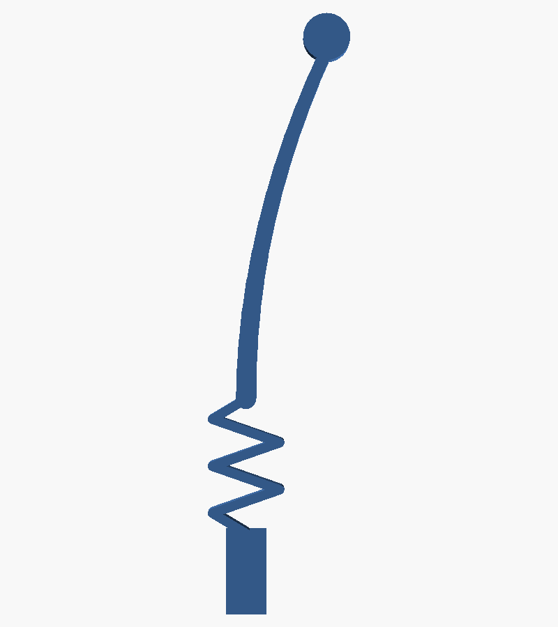

# Chotu body v2: Reachy-Mini style, lighter

Made 2026-11-05. v2 gives Chotu the Reachy Mini look (a bell-shaped body, a round head floating on top, a black goggle face with two big eyes, and slim antennas) and makes the moving parts lighter.

**Credit:** the look is inspired by Pollen Robotics' Reachy Mini. Their hardware design is shared under CC BY-NC-SA, so this personal look-alike is fine. Credit Pollen Robotics if you share it, and don't sell it. All the parts here were drawn from scratch to fit our cheaper parts.

## What changed from v1

| | v1 | v2 | Why |
|---|---|---|---|
| Body | Short orange cup, legs visible | Tall white **bell shell** (separate thin part) that hides the six legs. Only the rods show in the gap under the head | The Reachy Mini look: the head seems to float |
| Head | Box, one eye | Round "bean" head, 110 × 80 × 62 mm, with a black **goggle visor** and **two eyes**. The camera looks out of Chotu's **left** eye. The right eye is a dummy lens | Cuter, and the shape people recognise |
| Antennas | Thick orange stalks | Slim, with a **zigzag spring** so they flex, even in normal PLA | Lighter, and they wobble after each move |
| Walls | 2.5 mm | 1.8 mm, plus weight-saving windows in the hexagon, torso floor and head floor | Lighter |
| Inside | | **Same as v1**: base, bearing, the 6-servo hexagon, rods (67.8 mm) and head joints | It already fits, and the head maths file doesn't change |

**Weight of the printed plastic** (estimated from the STL files as if printed solid; real prints with 15–20% infill weigh less):

- **Head (what the 6 small servos lift): 178 g → 115 g, about 35% lighter.** This is the part that matters most for smooth moves.
- Torso: 180 g → 93 g, plus a 64 g body shell.
- Whole robot: roughly **0.7–0.85 kg** with electronics, against 1.35–1.5 kg for the real Reachy Mini. The base stays heavy on purpose: weight down low stops Chotu tipping over.

## Flexible antennas (normal PLA, the shape does the bending)

Each antenna is **two prints**:

- **`antenna.stl`**: a flat antenna with a **zigzag spring** at the bottom, then a slim curved stalk and a round tip. **Print it lying flat** (it already is in the file). Why flat: the plastic lines then run along the antenna, so it bends a lot and springs back instead of snapping. The zigzag works like a little spring, so the antenna wobbles after every move.
- **`antenna_hub.stl`**: sits on the servo's one-arm horn (pocket underneath, same as v1). The antenna's square bottom tab slides into the slot on top. Add a drop of glue, or a small M2 screw through the side hole.

Print settings for the antenna: 0.2 mm layers, **100% infill** (it's thin, so it's all walls anyway), PLA or PETG. PETG is even springier. Want it softer? Print the same `antenna.stl` in TPU.

## Files (all in `stl/v2/`)

| STL | Print in | Supports | Notes |
|---|---|---|---|
| `base_plate.stl` | PLA | No | Same as v1 |
| `base_shell.stl` | PLA | Only for the side holes | Thinner wall than v1 |
| `torso.stl` | PLA | Yes, for the 6 servo windows | Floor + servo hexagon + a ring the body shell slips over |
| `body_shell.stl` | PLA, white | No | Thin bell. Slips over the torso ring and is held by 3 M2 screws |
| `head_platform.stl` | PLA | Yes, under the 6 lugs | Now also holds the **camera** on a small bracket behind the left eye |
| `head_shell.stl` | PLA, white | Yes | Already flipped top-down for printing |
| `visor.stl` | PLA, **black** | No | Glue it into the goggle opening |
| `antenna.stl` ×2 | PLA or PETG | No | Print **flat**, 100% infill. Zigzag spring makes it flexible |
| `antenna_hub.stl` ×2 | PLA | No | Holds the antenna on the servo horn |

Design file: `chotu_v2.scad`. It loads `chotu.scad` and changes only what's new, so keep both files in the same folder.

## Still to confirm: your real part sizes

As we agreed, real sizes come first. v2 still uses the standard sizes for the MG90S, PCA9685, lazy-susan bearing and speaker, because I haven't had your measurements yet. **Before you print, send me your measurements** (or product links) and I'll update the numbers. It's only a few edits at the top of `chotu.scad`, and both versions update together.

